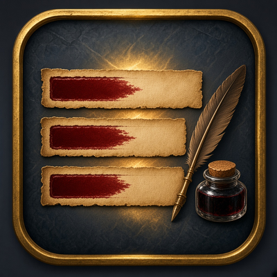
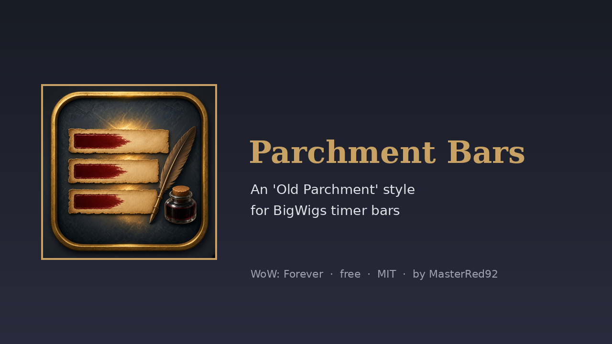
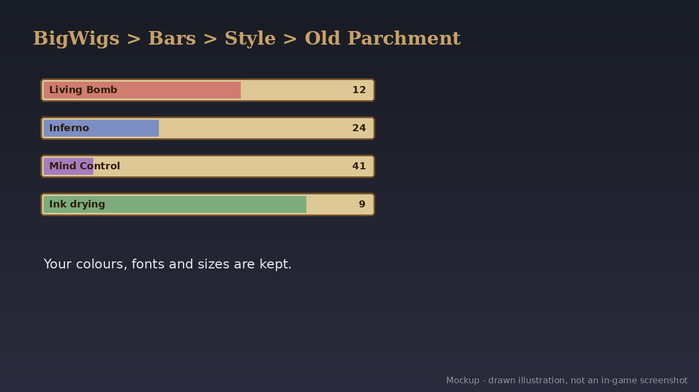

# Parchment Bars (WoW: Forever) v1.0.0

   

BigWigs timers, on paper. **Parchment Bars** adds an **Old Parchment** style to BigWigs: each bar sits on aged parchment in a tooltip-style border, the fill is softened so it reads like ink, and the text is dark ink.

- **Pick it** in BigWigs > Bars > Style > *Old Parchment*.
- **Keeps your setup:** your bar colours, texture, font and size are unchanged. The style only adds the paper, the border and the ink.
- **Nothing bundled:** it uses the parchment and border textures that are already in the WoW: Forever client.
- Try it with `/localbar 20 Ink drying`.

**Needs:** Required for anything to show: [BigWigs](https://www.curseforge.com/wow/addons/big-wigs).

## Download
- **Wago Addons:** coming at launch (Nov 4). The link goes here when the project is live.
- **CurseForge:** maybe later.
- **GitHub:** [Releases](https://github.com/masterred92/ParchmentBars/releases) (from the first tagged release) · [Issues](https://github.com/masterred92/ParchmentBars/issues)
- **More by Kenny:** [BRBoss](https://github.com/masterred92/BRBoss) · [GruntCount](https://github.com/masterred92/GruntCount) · [all WoW: Forever addons](https://github.com/masterred92/wow-forever-addons)

## Commands
`/parchment` shows where to pick the style.

## Install
Put the `ParchmentBars` folder in `World of Warcraft\_forever_\Interface\AddOns\` and restart the game or `/reload`.

## In-game test checklist (launch day)
1. Listed in AddOns with its icon.
2. BigWigs > Bars > Style lists 'Old Parchment'. Pick it, then `/localbar 20 test`: the bar has a parchment background and border, and dark text that's readable on your bar colour.
3. Emphasized bars and bars that end early don't leave an empty parchment frame behind.
4. Switch back to another style: bars look normal again.

## Licence
MIT. Written from scratch; no code copied from other addons. Free, no paid features. It doesn't automate gameplay: everything it does is a reaction you can see or something you typed.

## Development
`tests/run.sh [path-to-wow-ui-source-forever]` runs `luac -p`, luacheck, the mock-client tests and (with a path) an API check against Blizzard's Forever UI source and the host addons' source. GitHub Actions runs the tests on every push. The release workflow is a manual dry run that builds the zip with [BigWigsMods/packager](https://github.com/BigWigsMods/packager); publishing is switched off until the Wago project ID is added (see the comments in `.github/workflows/release.yml`).
